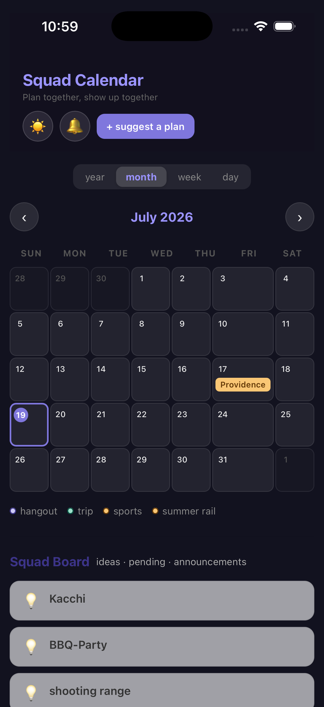
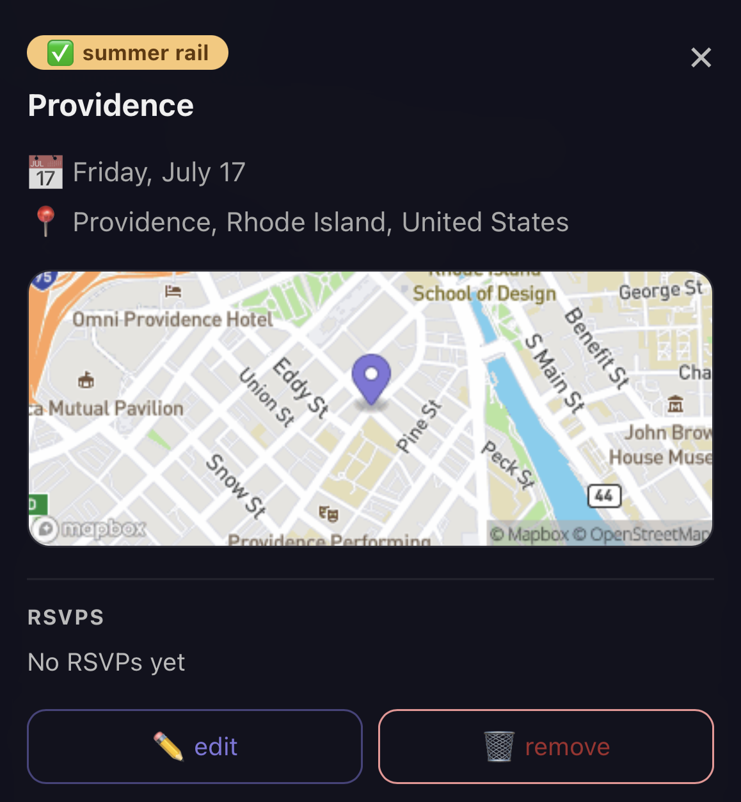
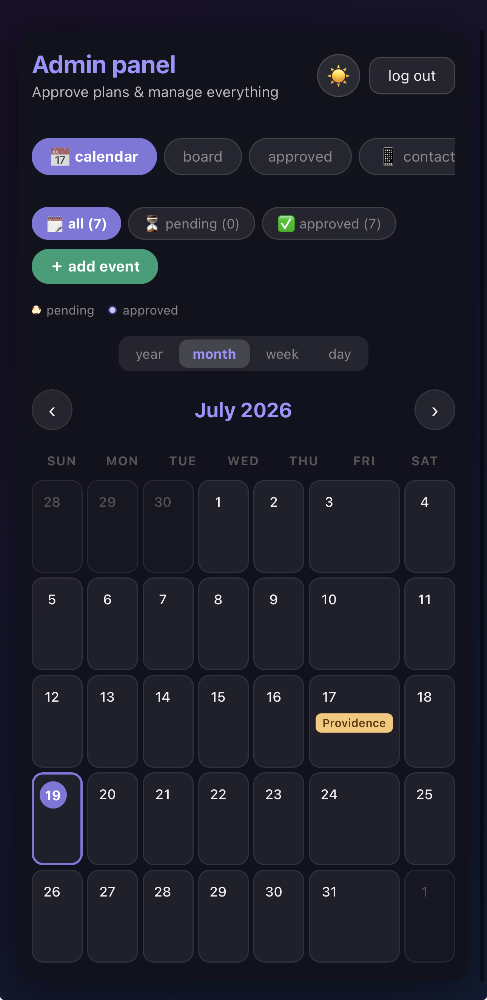

# Squad Calendar

A full-stack event-planning application for coordinating activities within a small group. Built and maintained for an 11-person friend group, it runs as a web app and as a native iOS app compiled from a single shared codebase.

**Live:** [squadcal.app](https://squadcal.app)

<p align="center">
  
  
  
</p>

---

## Overview

Coordinating plans across a group chat is messy — dates get buried, no one knows who is actually coming, and reminders fall through. Squad Calendar centralizes the process: members propose events, RSVP in a single tap, and receive automated SMS and push reminders before each one. A separate administrative layer handles contacts, reminder targeting, and group announcements.

The project spans the full stack: a React front end, a Firebase back end with scheduled serverless functions, third-party integrations for SMS and mapping, and a native iOS build distributed through TestFlight — all from one codebase.

---

## Core Functionality

**Member-facing**
- Calendar with year, month, week, and a time-grid day view, including multi-day event spanning and a live current-time indicator
- Event proposals with dates, autocompleted locations, categories, and notes; dateless "ideas" post to a shared board
- One-tap RSVP with device-remembered identity and an optional phone number for reminders
- Push notifications and full dark-mode theming

**Administrative**
- Contact management and per-event reminder targeting
- SMS announcements with per-recipient delivery tracking and a rolling message history
- Automated day-before reminders dispatched by scheduled Cloud Functions
- Access gated by Firebase Authentication using a custom admin claim

---

## Architecture

**Single codebase, two targets.** The same React application is deployed to the web via Cloudflare Pages and wrapped as a native iOS app with Capacitor, so features ship to both surfaces from one build.

**Serverless back end.** Firestore provides the real-time data layer, with client listeners keeping every device in sync. Cloud Functions (v2) handle notification fan-out, SMS dispatch with per-recipient logging, and scheduled jobs such as daily reminder dispatch and message-log rotation.

**Security model.** Firestore security rules validate and authorize every write. Administrative operations require a verified custom auth claim rather than mere authentication; public sign-up is disabled, and third-party API tokens are URL-restricted.

---

## Engineering Notes

A few problems that were interesting to work through:

- **Shared web/native codebase** — reconciling differences between the browser and the iOS WKWebView (authentication persistence, viewport behavior, and touch/gesture handling) so a single build behaves correctly on both.
- **iOS scene-lifecycle migration** — adopting the `UIScene`-based lifecycle required by current iOS SDKs, including a custom bridge view controller to configure the web view natively.
- **Role-based authorization** — moving admin access from "any authenticated user" to a verified custom claim, enforced consistently in both the security rules and the Cloud Functions.
- **Scheduled reminders** — time-zoned cron functions that fan out notifications the evening before an event without duplicating sends.

---

## Tech Stack

| Layer | Technology |
|---|---|
| Front end | React |
| Back end | Firebase — Firestore, Authentication, Cloud Functions v2, Cloud Messaging |
| Scheduled jobs | Cloud Functions cron (reminder dispatch, log rotation) |
| SMS | Textbelt |
| Maps & geocoding | Mapbox |
| Web hosting | Cloudflare Pages (CI/CD from this repository) |
| iOS | Capacitor (native shell, distributed via TestFlight) |

---

## Running Locally

```bash
git clone https://github.com/Muhtasim19/squad-calendar.git
cd squad-calendar
npm install

# copy the env template and add your own Firebase and Mapbox keys
cp .env.example .env

npm start
```

Cloud Functions live in `functions/` and deploy with the Firebase CLI:

```bash
cd functions && npm install
firebase deploy --only functions
```

**iOS build**

```bash
npm run build
npx cap sync ios
npx cap open ios   # then run from Xcode
```

---

## License

MIT © 2026 Muhtasim Haq